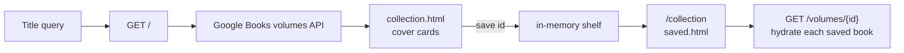
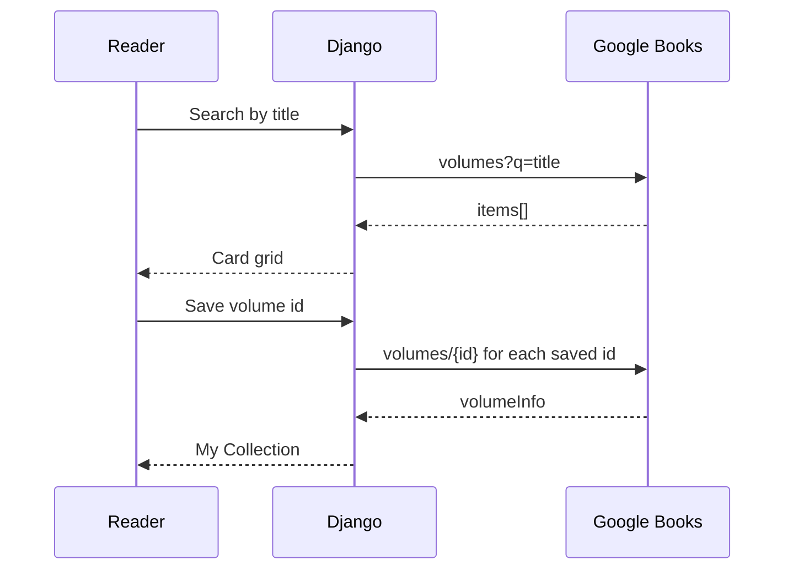

# Book-a-thon

Search the world’s books, open their catalogue pages, and keep a **personal
collection** — a Django front end over the [Google Books API](https://developers.google.com/books).
Type a title, browse cover cards, save the ones you want to read next.

<p>
  
  
  
  
</p>

A reading list is only useful if you can find the next book in seconds.
Book-a-thon is a thin, searchable catalogue: one query hits Google Books,
results render as cards (cover, authors, publisher, popularity), and a
saved collection lives on `/collection`.

---

## Why it matters

Storefronts bury discovery under ads and recommendations you did not ask
for. This app does one job well: **search → inspect → save**. It is the
same pattern as a library OPAC, pointed at a public book graph instead of
a local shelf list.

## What it does

- **Title search** on the home page — Google Books returns matching volumes.
- **Result cards** with cover art, authors, publisher, a popularity signal
  (`ratingsCount`), and a link out to the official info page.
- **My Collection** — save a volume by id and reopen it later as a shelf.
- **Landing slideshow** of reading imagery so the catalogue feels like a
  bookstore, not a raw API client.

## How a search becomes a shelf





Saved ids stay in process memory for the demo (`save` in `Home/views.py`).
Restarting the server clears the shelf; swapping that list for a Django
model is the natural next step.

## Architecture

```
Book_a_thon/
├── manage.py
├── Book_a_thon/          Django project (settings, urls, wsgi)
├── Home/
│   ├── views.py          search, save, collection
│   └── urls.py           /  /collection  /saved
├── templates/            main, collection, saved, display
└── static/               covers, navbar, card CSS
```

| Layer | Choice |
| ----- | ------ |
| Web | Django 4 |
| Catalogue | Google Books API v1 |
| HTTP client | `requests` |
| Templates | Django + Bootstrap 4 |

## Quickstart

```bash
python -m venv .venv && source .venv/bin/activate
pip install -r requirements.txt

cd Book_a_thon
python manage.py runserver
```

Then open `http://127.0.0.1:8000/`, search a title, and add books to
**My Collection**.

Search needs a Google Books API key in `Home/views.py` (`key = "..."`).
Use your own key from the [Google Cloud console](https://console.cloud.google.com/)
— do not commit a shared production key.

## Project layout (routes)

| Path | View | Role |
| ---- | ---- | ---- |
| `/` | `main` | search form + results |
| `/collection/` | `collection` | saved shelf |
| `/saved/` | `addbook` | append a volume id, then show the shelf |

This started as a team hackathon build. The fork keeps the original product
name and documents the catalogue flow so the repo reads as a product, not
an empty Django skeleton.
